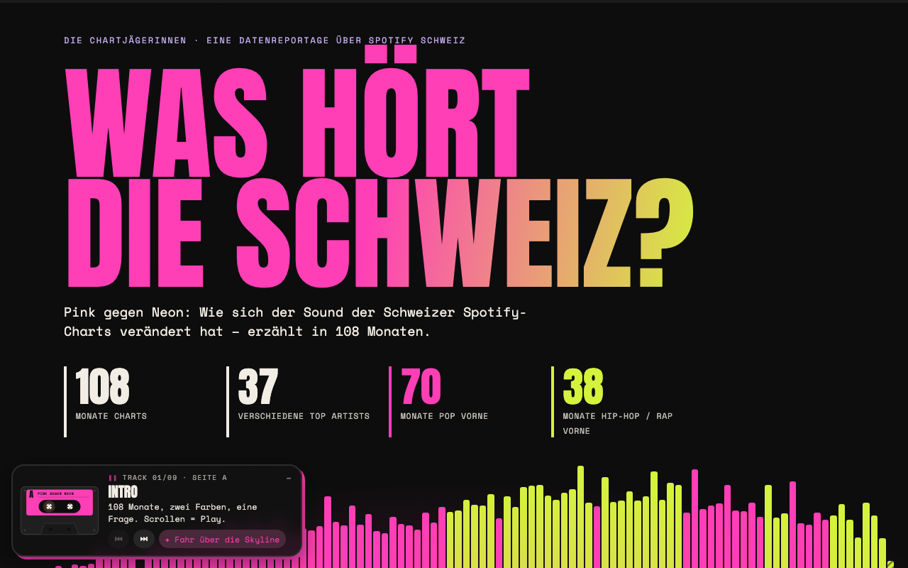
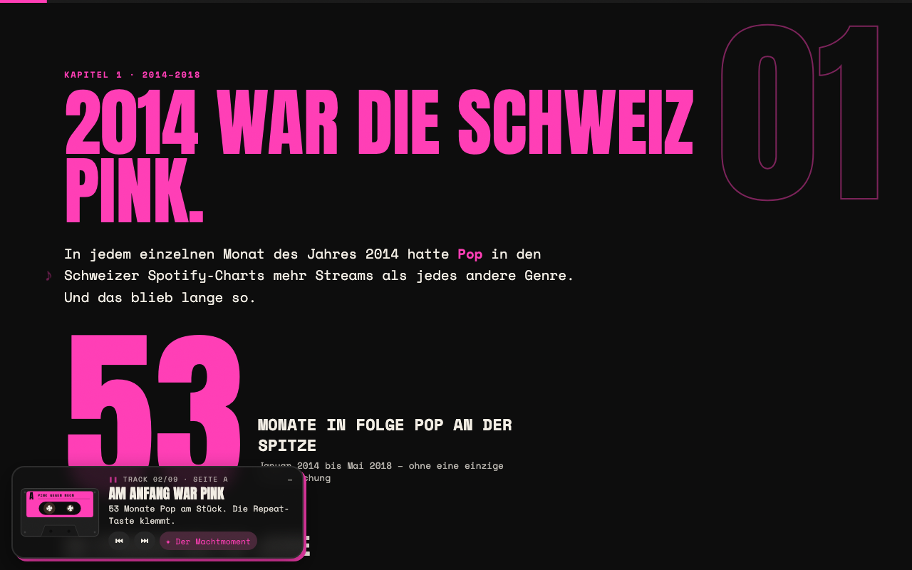
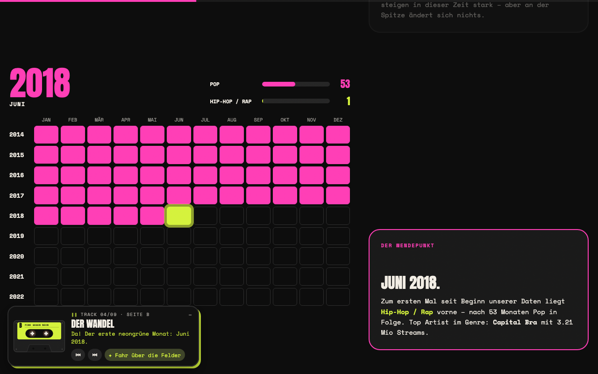
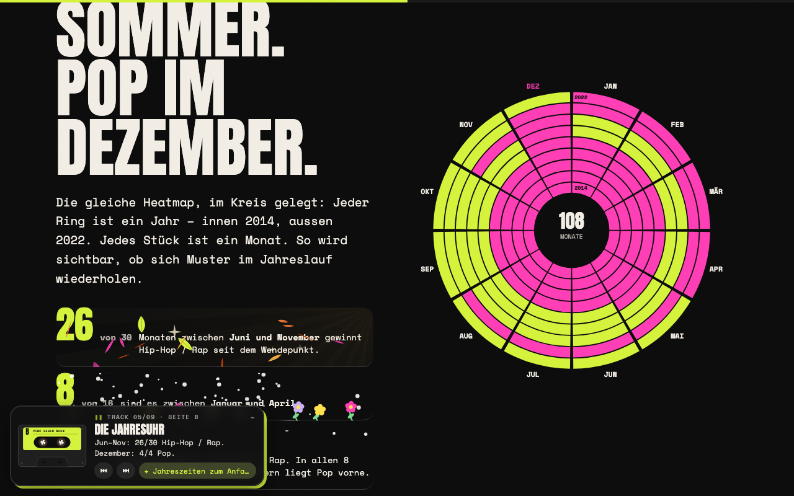
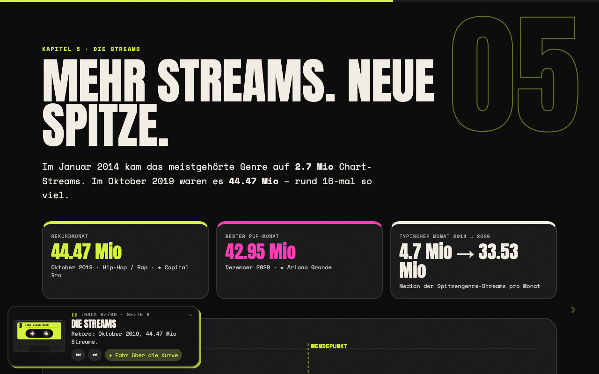
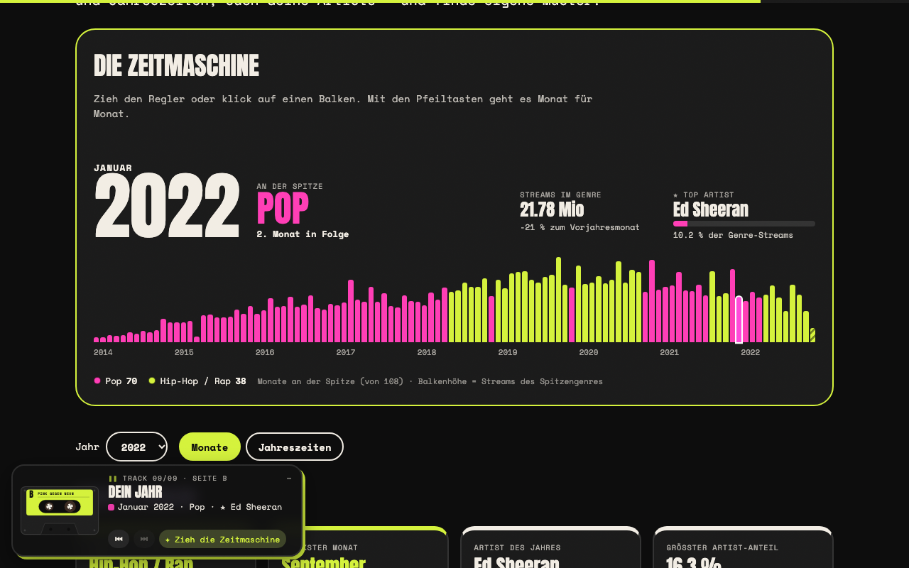
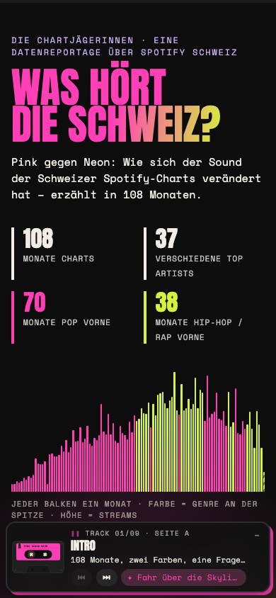

# Pink gegen Neon – Was hört die Schweiz?

Data-Story-Projekt im Modul IM3 von **Die Chartjägerinnen**. Die interaktive Reportage untersucht, welches Genre die Schweizer Spotify-Charts in jedem Monat zwischen 2014 und 2022 dominierte und welcher Artist innerhalb dieses Top-Genres am stärksten war. Aus wöchentlichen Chartdaten entsteht eine Geschichte über Pop, Hip-Hop / Rap und den Wandel des Schweizer Streaming-Geschmacks.

**Website:** https://im3.okurocic.myhostpoint.ch/im3-tophits/frontend/index.html?v=2  
**API – Monatsresultate:** https://im3.okurocic.myhostpoint.ch/im3-tophits/backend/api/  
**API – Genre-Daten:** https://im3.okurocic.myhostpoint.ch/im3-tophits/backend/api/?resource=genres  
**GitHub:** https://github.com/finjawittlin/im3-tophits

## Inhalt

1. [Projektbeschreibung und Zielsetzung](#1-projektbeschreibung-und-zielsetzung)
2. [Screenshots](#2-screenshots)
3. [Marktstand](#3-marktstand)
4. [Installation und Ausführung](#4-installation-und-ausführung)
5. [ETL-Prozess](#5-etl-prozess)
6. [Datenqualität und Grenzen](#6-datenqualität-und-grenzen)
7. [Datenbank und API](#7-datenbank-und-api)
8. [Frontend](#8-frontend)
9. [Technische Umsetzung und Projektstruktur](#9-technische-umsetzung-und-projektstruktur)
10. [Learnings](#10-learnings)
11. [Schwierigkeiten und Lösungen](#11-schwierigkeiten-und-lösungen)
12. [Ressourcen](#12-ressourcen)
13. [Lizenz und Team](#13-lizenz-und-team)

---

## 1. Projektbeschreibung und Zielsetzung

**Forschungsfrage:** Welches Genre wurde in welchem Monat in der Schweiz zwischen 2014 und 2022 am meisten gestreamt?

Zusätzlich zeigen wir den **Top Artist innerhalb des jeweiligen Top-Genres**.

**Ziel:** Aus wöchentlichen Spotify-Chartdaten eine verständliche, interaktive Geschichte machen. Die Daten werden mit einem eigenen ETL-Prozess in PHP gelesen und aufbereitet, in einer MySQL-Datenbank gespeichert, über eine JSON-API ausgeliefert und im Browser als Scrollytelling-Reportage dargestellt.

Der visuelle rote Faden ist das Duell **«Pink gegen Neon»**:

- **Pink** steht für Pop.
- **Neon** steht für Hip-Hop / Rap.
- Die Reportage zeigt aber auch weitere Hauptgenres wie Electronic / Dance, Rock, R&B / Soul, Latin und Indie / Alternative.

Datenfluss:

```text
CSV → Extract → Transform → Qualitätschecks → Load → MySQL → API → Frontend
```

Die Auswertung umfasst **108 Monate** von Januar 2014 bis Dezember 2022.

## 2. Screenshots

Die Screenshots zeigen die aktuelle Frontend-Version mit den Daten aus der Datenbank.

| | |
|---|---|
|  Startseite: jeder Balken ein Monat |  Kapitel 1: die Pop-Phase |
|  Kapitel 2: der Wandel |  Kapitel 3: die Jahresuhr |
|  Kapitel 5: Streams |  Kapitel 7: die Zeitmaschine |



## 3. Marktstand

Am Marktstand erklären wir den Datenfluss vom Rohdatensatz bis zur fertigen interaktiven Story:

```text
Spotify-Chartdaten → CSV → PHP-ETL → Qualitätschecks → MySQL → API → Frontend
```

Dabei zeigen wir insbesondere, wie aus vielen einzelnen Spotify-Genres gröbere Hauptgenres entstehen, wie die Monatswerte berechnet werden und welche Grenzen die Daten haben.

**Noch einzufügen:** Das verlangte Foto des Marktstands als `docs/marktstand.jpg`.

Sobald das Bild vorhanden ist, kann folgende Zeile aktiviert werden:

```md

```

## 4. Installation und Ausführung

### Voraussetzungen

- PHP 8.0 oder neuer mit `pdo_mysql`
- MySQL / MariaDB
- Rohdaten-CSV `spotify_ch_2014_2022.csv`
- Für das Online-Projekt wird Hostpoint verwendet; dort steht PHP 8.3 zur Verfügung.

### Schritte

1. **Repository klonen**

   ```bash
   git clone https://github.com/finjawittlin/im3-tophits.git
   cd im3-tophits
   ```

2. **Konfiguration anlegen**

   ```bash
   cp config.template.php config.php
   ```

   In `config.php` Datenbank-Host, Datenbankname, Benutzername und Passwort eintragen.

   `config.php` ist in `.gitignore` und darf nicht ins öffentliche Repository gelangen.

3. **Daten bereitstellen**

   Den Kaggle-Datensatz herunterladen und aus `charts.csv` die Schweizer Zeilen für 2014 bis 2022 filtern.

   Verwendeter Filter:

   ```bash
   awk -F',' 'NR==1 {print; next} {d=$1; gsub("/", "-", d)} $2=="ch" && d >= "2014-01-01" && d <= "2022-12-31" {print}' charts.csv > spotify_ch_2014_2022.csv
   ```

   Die gefilterte Datei kommt nach:

   ```text
   data/spotify_ch_2014_2022.csv
   ```

   Die CSV ist wegen ihrer Grösse nicht im GitHub-Repository.

4. **Extract testen**

   ```bash
   php backend/etl/extract.php
   ```

5. **Transform und Qualitätschecks testen – ohne Datenbankänderung**

   ```bash
   php backend/etl/transform.php
   ```

6. **Daten in die Datenbank laden**

   ```bash
   php backend/etl/load.php
   ```

   `load.php` ersetzt die Inhalte von `monthly_results` und `monthly_genre_streams` innerhalb einer Transaktion.

   Im Browser ist `load.php` nur mit gültigem ETL-Token erreichbar. In der produktiven Konfiguration ist der Token aktuell leer:

   ```php
   $etlToken = '';
   ```

   Damit ist der Browser-Aufruf gesperrt.

7. **Website lokal starten**

   ```bash
   php -S 127.0.0.1:8000
   ```

   Danach:

   ```text
   http://127.0.0.1:8000/frontend/
   ```

### Deployment auf Hostpoint

Die Projektdateien werden per PhpStorm Deployment / FTP auf Hostpoint übertragen.

Wichtig:

- `config.php` enthält geheime Zugangsdaten und wird nicht über GitHub verteilt.
- `data/.htaccess` verhindert den öffentlichen Download der Rohdaten-CSV.
- `mock-data.json` wird nicht mehr verwendet.
- Das Frontend lädt echte Daten aus der API.
- Für CSS und JavaScript werden Cache-Busting-Parameter (`?v=2`) verwendet, damit Browser nach einem Deployment die aktuelle Version laden.

## 5. ETL-Prozess

### Datenquelle

Verwendet wird der Kaggle-Datensatz **«Spotify tracks chart dataset (2014-2022)»** von Julian Freyberg (`jfreyberg`):

https://www.kaggle.com/datasets/jfreyberg/spotify-chart-data/

Laut Datensatzbeschreibung basieren die Daten auf kworb.net und der offiziellen Spotify-API.

Die gefilterte Datei `data/spotify_ch_2014_2022.csv` enthält die Spalten:

```text
date, country, position, streams, track_id, artists, artist_genres, duration, explicit, name
```

### Extract – `backend/etl/extract.php`

Der Extract:

- liest die CSV Zeile für Zeile als Generator (`extractRows()`), damit auch grosse Dateien speicherschonend verarbeitet werden;
- sucht Spalten anhand ihrer Namen und prüft Pflichtspalten;
- unterstützt einen dynamischen Dateipfad über `--csv=…`, `$csvFile` in `config.php` oder den Standardpfad;
- wirft bei fehlender oder ungültiger Datei eine `ExtractException`;
- protokolliert fehlerhafte CSV-Zeilen;
- liefert beim direkten Aufruf einen Bericht über Spalten, Zeilen, Chart-Wochen und Zeitraum.

**Wichtige Abgrenzung:** Der aktuelle Extract lädt den Kaggle-Datensatz nicht automatisch aus dem Internet herunter. Die CSV wird vorher bereitgestellt und danach dynamisch durch das ETL eingelesen. Das ist eine technische Grenze der aktuellen Projektversion.

### Transform – `backend/etl/transform.php`

`transform.php` verarbeitet die vom Extract gelieferten Zeilen direkt:

```text
extractRows(...) → transformRows(...)
```

Dabei werden:

- Datumswerte geprüft;
- jede Chart-Woche dem Monat ihres Datums zugeordnet;
- Streams validiert;
- Duplikate erkannt;
- Artists und Spotify-Genres aus den Python-Listen der CSV gelesen;
- Spotify-Genres zu Hauptgenres zusammengefasst;
- Streams pro Monat und Hauptgenre summiert;
- Top Genre und Top Artist pro Monat bestimmt;
- pro Monat und Genre zusätzliche Kennzahlen für das Frontend berechnet.

Gespeichert werden unter anderem:

- Streams
- Anzahl Chart-Wochen
- Anzahl Chart-Einträge
- Explicit-Streams
- Top Artist
- Top Song

### Genre-Zuordnung

Hauptgenres:

- Pop
- Hip-Hop / Rap
- Electronic / Dance
- Rock
- R&B / Soul
- Latin
- Indie / Alternative
- Other
- Unknown

Die Reihenfolge der Regeln bestimmt die Priorität:

```text
Latin
→ Hip-Hop / Rap
→ R&B / Soul
→ Rock
→ Indie / Alternative
→ Electronic / Dance
→ Pop
```

Sonderfälle:

- `trap latino`, `latin rap`, `reggaeton`, `dembow` und ähnliche Begriffe werden Latin zugeordnet.
- `dance pop`, `pop dance` und `electropop` zählen zu Pop und werden nicht allein wegen `dance` oder `electro` als Electronic / Dance klassifiziert.
- Ein allgemeiner `dance`-Treffer wird bewusst nicht verwendet, weil Begriffe wie `australian dance` sonst Pop-Artists fälschlich Electronic / Dance zuordnen können.
- Der Mischbegriff `pop rap` wird als Pop behandelt und löst nicht automatisch Hip-Hop / Rap aus.
- `electronic trap` wird Electronic / Dance zugeordnet, während normales `trap` weiterhin zu Hip-Hop / Rap zählt.
- `trap soul` wird R&B / Soul zugeordnet.
- Eindeutige elektronische Genres wie `edm`, `house`, `electro house`, `moombahton` oder `hardstyle` werden Electronic / Dance zugeordnet.
- `Unknown` bedeutet, dass für den Artist kein Spotify-Genre vorhanden ist.
- `Other` bedeutet, dass Genres vorhanden sind, aber keine Regel passt.
- Bei Kollaborationen zählt der **erste gelistete Artist** als Hauptartist. Die Genre-Tags der CSV können dabei Genres mehrerer beteiligter Artists enthalten; dies ist eine methodische Grenze der Quelle.

Die Genre-Regeln wurden anhand auffälliger Resultate mit konkreten Artists und Songs geprüft. Dabei zeigte sich unter anderem, dass `pop rap` fälschlich Hip-Hop / Rap auslösen konnte, allgemeine `dance`-Treffer Pop-Artists zu Electronic / Dance verschieben konnten und `electronic trap` nicht wie normales `trap` behandelt werden sollte. Nach den Korrekturen wurden die gesamten Daten erneut transformiert, mit den Qualitätschecks geprüft und in die Datenbank geladen.

### Qualitätschecks – `backend/etl/quality.php`

Die Qualitätschecks laufen automatisch bei jedem Transform.

Jeder Check meldet:

- **OK** – keine relevante Auffälligkeit
- **WARNUNG** – Daten können geladen werden, Auffälligkeit wird aber dokumentiert
- **FEHLER** – Load wird abgebrochen

Geprüft werden unter anderem:

| Check | Prüfung |
|---|---|
| Zeilen | ungültige Daten, Streams, Spaltenzahl und Duplikate |
| Monate | lückenloser Zeitraum |
| Wochen pro Monat | Zahl der Chart-Wochen und ungewöhnliche Zeitabstände |
| Einträge pro Woche | auffällig kleine Wochen |
| Unknown | Anteil fehlender Spotify-Genres |
| Other | Anteil nicht zugeordneter Spotify-Genres |
| Konsistenz | Stream-Summen, eindeutige Monat-Genre-Kombinationen und korrektes Top Genre |

### Load – `backend/etl/load.php`

Der Load ist abgesichert:

1. Extract, Transform und Qualitätschecks laufen zuerst.
2. Bei einem Qualitätsfehler wird abgebrochen.
3. Es kann nur ein Load gleichzeitig laufen.
4. Die Tabellen werden geprüft bzw. angelegt.
5. Die eigentliche Datenänderung läuft innerhalb einer Datenbanktransaktion.
6. Nach dem Schreiben werden Anzahl Zeilen und Stream-Summen kontrolliert.
7. Erst danach erfolgt `COMMIT`.
8. Bei Fehlern erfolgt `ROLLBACK`.

Dadurch soll verhindert werden, dass nach einem abgebrochenen Load eine halb aktualisierte Datenbank zurückbleibt.

## 6. Datenqualität und Grenzen

Der aktuelle Qualitätslauf verarbeitet:

- **87'432 Zeilen**
- **108 Monate** von 2014-01 bis 2022-12
- **465 Chart-Wochen**
- **913 Monat-Genre-Werte**
- **4'812'682'893 Streams** in den verarbeiteten Chartdaten

### Auffälligkeiten

**April 2015:** Der Monat enthält nur eine erfasste Chart-Woche (`2015-04-30`). Zwischen `2015-03-22` und `2015-04-30` liegt eine Lücke von 39 Tagen. Aussagen für April 2015 beruhen deshalb auf deutlich weniger Daten als andere Monate.

**Unvollständige Wochen:** 50 Wochen enthalten weniger als die Hälfte des Medians der wöchentlichen Einträge. Besonders frühe Wochen im Jahr 2014 enthalten teilweise nur rund 50 Chart-Einträge.

**Unknown:** 620 Zeilen haben kein Spotify-Genre. Diese Zeilen entsprechen rund **0,75 % der Streams**.

**Other:** 969 Zeilen haben Spotify-Genres, die von keiner Regel erfasst werden. Sie entsprechen rund **1,01 % der Streams**. Beispiele sind `adult standards`, `lounge`, `easy listening`, `vocal jazz` und `partyschlager`.

### Methodische Grenzen

- Die Daten zeigen **Spotify-Chartdaten**, nicht das vollständige Hörverhalten aller Spotify-Nutzerinnen und -Nutzer in der Schweiz.
- `artist_genres` sind Artist-Genres, keine präzisen Track-Genres.
- Die Genre-Zuordnung ist eine eigene, dokumentierte Heuristik.
- Eine Chart-Woche wird vollständig dem Monat ihres Datums zugerechnet, auch wenn die Kalenderwoche über eine Monatsgrenze reicht.
- Monate mit vier und fünf Chart-Wochen sind bei absoluten Stream-Summen nicht direkt gleich lang beobachtet. Deshalb speichert das Projekt `chart_weeks` und bietet im Explorer zusätzlich «Ø pro Woche».
- Die ursprüngliche CSV wird aktuell manuell aus Kaggle bereitgestellt; der Download selbst ist nicht Teil des automatischen Extracts.

## 7. Datenbank und API

Die Datenbank verwendet MySQL / MariaDB mit InnoDB und `utf8mb4`.

### Tabelle `monthly_results`

Pro Monat:

- `month`
- `top_genre`
- `genre_streams`
- `top_artist`
- `artist_streams`

Aktueller Stand: **108 Monatsresultate**.

### Tabelle `monthly_genre_streams`

Pro Monat und Genre:

- `streams`
- `chart_weeks`
- `chart_entries`
- `explicit_streams`
- `top_artist`
- `artist_streams`
- `top_track`
- `top_track_artist`
- `top_track_streams`

Aktueller Stand: **913 Monat-Genre-Werte**.

### API

`backend/api/index.php` liest die Datenbank nur lesend aus und liefert JSON.

Monatsresultate:

```text
https://im3.okurocic.myhostpoint.ch/im3-tophits/backend/api/
```

Alternativ:

```text
https://im3.okurocic.myhostpoint.ch/im3-tophits/backend/api/?resource=months
```

Alle Genre-Monatswerte:

```text
https://im3.okurocic.myhostpoint.ch/im3-tophits/backend/api/?resource=genres
```

`backend/etl/unload.php` verwendet dieselbe Ausgabelogik.

## 8. Frontend

### «Pink gegen Neon» – interaktive Datenreportage

`frontend/index.html` lädt die Daten live über die Backend-API.

| | Kapitel | Inhalt |
|---|---|---|
| Hero | Was hört die Schweiz? | Skyline aus allen Monaten, Farbe = Genre, Höhe = Streams |
| 01 | Pink | Pop-Phase, Artists und Machtmomente |
| – | Quiz | Frage zum Aufstieg von Hip-Hop / Rap |
| – | Farbwischer | Übergang von Pink zu Neon |
| 02 | Der Wandel | Heatmap und zeitlicher Wendepunkt |
| 03 | Die Jahresuhr | Monate, Jahre und Saisonmuster |
| 04 | Die Gesichter | wichtige Artists vor und nach dem Wandel |
| 05 | Die Streams | Streams im Zeitverlauf |
| 06 | Fazit | Kernaussagen und Grenzen der Daten |
| 07 | Dein Jahr | Zeitmaschine und Explorer |

Die Texte und Kennzahlen werden aus den geladenen Daten berechnet.

### Explorer

Der Explorer ermöglicht unter anderem:

- Auswahl von Jahren und Monaten
- Jahreszeiten-Auswertung
- Ranglisten der Genres
- Ansicht «Ø pro Woche»
- Top Songs und Top Artists
- Explicit-Anteil
- Zeitverläufe
- Artist-Suche

### Mixtape-Begleiter

`frontend/guide.js` verwendet eine Kassette als roten Faden:

- Seite A für den Pink-/Pop-Teil
- Kassette wird beim Übergang «umgedreht»
- Seite B für den Neon-/Hip-Hop-Teil
- Bonus-Bereich für den Explorer
- Trackliste, Hinweise und versteckter Hidden Track

### Barrierefreiheit und Bewegung

Das Frontend berücksichtigt unter anderem:

- Skip-Link
- Tastaturbedienung
- sichtbaren Fokus
- `prefers-reduced-motion`

Jahreszeiten-Effekte werden nur in den dafür vorgesehenen Bereichen ausgelöst.

## 9. Technische Umsetzung und Projektstruktur

- **Backend:** PHP 8, PDO, Prepared Statements, MySQL / MariaDB
- **Frontend:** HTML, CSS, Vanilla JavaScript
- **Visualisierungen:** SVG, HTML und Canvas
- **Hosting:** Hostpoint
- **Schriften:** Anton und Space Mono über Google Fonts
- **Versionsverwaltung:** Git / GitHub

```text
im3-tophits/
├── config.template.php      Vorlage ohne echte Zugangsdaten
├── config.php               nur lokal/Server, durch .gitignore geschützt
├── backend/
│   ├── api/
│   │   └── index.php        JSON-API
│   └── etl/
│       ├── extract.php      CSV lesen und prüfen
│       ├── transform.php    Daten aufbereiten und aggregieren
│       ├── quality.php      Qualitätschecks
│       ├── load.php         Datenbank-Load mit Transaktion
│       ├── unload.php       JSON-Ausgabe
│       └── schema.sql       Datenbankschema
├── data/
│   ├── .htaccess            schützt die Rohdaten vor öffentlichem Zugriff
│   └── spotify_ch_2014_2022.csv   nicht im GitHub-Repo
├── frontend/
│   ├── index.html
│   ├── style.css
│   ├── script.js
│   ├── story.js
│   └── guide.js
└── docs/
    └── screenshots/
```

## 10. Learnings

Im Projekt haben wir besonders gelernt:

- wie ein vollständiger Datenfluss von Rohdaten über ETL, Datenbank und API bis zum Frontend funktioniert;
- dass Datenqualität nicht nur bedeutet, dass Code ohne Fehler läuft: fehlende Wochen, unterschiedlich viele Chart-Einträge und unvollständige Zeiträume müssen ebenfalls geprüft und erklärt werden;
- wie wichtig transparente Transformationsregeln sind, wenn sehr viele Spotify-Genres zu wenigen verständlichen Hauptgenres zusammengefasst werden;
- dass eine technisch korrekte Regel fachlich trotzdem unplausible Resultate erzeugen kann und Genre-Regeln deshalb mit echten Artists und Songs geprüft werden müssen;
- wie Prepared Statements, Transaktionen, `COMMIT` und `ROLLBACK` eine Datenbank robuster machen;
- wie Frontend und Backend über eine JSON-API getrennt voneinander arbeiten;
- wie Git, GitHub, Hostpoint und Deployment zusammenspielen;
- wie wichtig es ist, Zugangsdaten, Datenbankpasswörter und Tokens nicht im öffentlichen Repository zu speichern;
- dass Browser- und Server-Caching nach einem Deployment dazu führen können, dass trotz neuer Dateien scheinbar noch eine alte Website sichtbar ist.

## 11. Schwierigkeiten und Lösungen

| Schwierigkeit | Lösung |
|---|---|
| Artists und Genres stehen als Python-Listen in der CSV | eigener Parser `parsePythonList()` |
| Namen mit Apostrophen konnten beim einfachen Ersetzen von Anführungszeichen kaputtgehen | zeichenweises Parsen der Listen |
| Viele widersprüchliche Spotify-Genres pro Artist | feste Hauptgenre-Regeln, Prioritäten, `Other` und `Unknown` |
| Zu breite Genre-Regeln führten zu unplausiblen Zuordnungen, z. B. `pop rap`, allgemeines `dance` oder `electronic trap` | Regeln anhand echter Artists und Songs geprüft und präzisiert; danach Qualitätscheck und Reload |
| Genre-Tags bei Kollaborationen können Genres mehrerer beteiligter Artists enthalten | erster gelisteter Artist wird als Hauptartist verwendet; Einschränkung wird transparent dokumentiert |
| Wöchentliche Daten müssen monatlich aggregiert werden | jede Chart-Woche zählt zum Monat ihres Datums; `chart_weeks` wird gespeichert |
| April 2015 enthält nur eine Chart-Woche | Qualitätswarnung und transparente Dokumentation |
| Manche Wochen enthalten deutlich weniger Chart-Einträge | Qualitätscheck «Einträge pro Woche» |
| Ein fehlerhafter Load könnte Daten halb überschreiben | Transaktion, Prüfungen, `COMMIT` / `ROLLBACK` |
| `load.php` darf nicht öffentlich frei ausführbar sein | Browser-Zugriff nur mit Token; produktiv ist der Token leer und damit gesperrt |
| Rohdaten sollen nicht öffentlich herunterladbar sein | `data/.htaccess` |
| Frontend zeigte nach Deployment teilweise eine alte Version | Cache-Busting mit `?v=2` und Kontrolle der Dateien auf Hostpoint |
| GitHub-Push schlug wegen abgelaufenem Token fehl | neuen Personal Access Token erstellt und macOS-Keychain als Credential Helper eingerichtet |
| Team arbeitet an gemeinsamem Repository | Änderungen über Git pull/commit/push synchronisiert |

## 12. Ressourcen

| Ressource | Verwendung | Stand / Abruf |
|---|---|---|
| [Kaggle: Spotify tracks chart dataset (2014-2022)](https://www.kaggle.com/datasets/jfreyberg/spotify-chart-data/), Julian Freyberg, Version 4, Lizenz CC BY 4.0 | Rohdaten | Metadaten geprüft: 11.11.2026; ursprüngliches Downloaddatum nicht dokumentiert |
| [kworb.net](https://kworb.net/spotify/) | Ursprung der Chartdaten laut Kaggle-Beschreibung | über Kaggle-Dokumentation nachvollzogen |
| Spotify Web API | Ursprung ergänzender Spotify-Metadaten laut Kaggle-Beschreibung | über Kaggle-Dokumentation nachvollzogen |
| [Google Fonts](https://fonts.google.com/) – Anton, Space Mono | Schriften | im Projekt verwendet |
| [PHP-Dokumentation](https://www.php.net/manual/de/) | PHP, PDO, CSV-Verarbeitung, Transaktionen | im Projekt verwendet |
| Hostpoint | Webhosting und MySQL | produktive Umgebung |
| PhpStorm | Entwicklung und Deployment | im Projekt verwendet |
| Git / GitHub | Versionsverwaltung und Zusammenarbeit | im Projekt verwendet |
| Claude Code / KI-Unterstützung | Unterstützung bei Frontend, ETL, Qualitätschecks und Dokumentation | im Projekt verwendet |
| IM3-Unterrichtsunterlagen | Anforderungen, ETL, Datenbank und Projektstruktur | Modulunterlagen HS26 |

## 13. Lizenz und Team

### Daten

Der Kaggle-Datensatz wird im Projekt gemäss der dort angegebenen **Creative Commons Attribution 4.0 International (CC BY 4.0)** verwendet.

Namensnennung:

> Julian Freyberg, «Spotify tracks chart dataset (2014-2022)», Kaggle.

### Code

Aktuell liegt keine separate Open-Source-Lizenzdatei im Repository. Solange keine `LICENSE` ergänzt wird, ist der Projektcode nicht automatisch zur freien Weiterverwendung lizenziert.

### Team

**Die Chartjägerinnen – IM3, HS26**

---

## Kurzfazit

Die Datenstory zeigt, wie sich die dominierenden Genres in den Schweizer Spotify-Charts zwischen 2014 und 2022 Monat für Monat verändert haben. Das Projekt verbindet Datenaufbereitung, Qualitätskontrolle, Datenbank, API und interaktives Frontend. Gleichzeitig macht es transparent, wo die Daten unvollständig sind und welche methodischen Entscheidungen – insbesondere die Genre-Zuordnung – die Resultate beeinflussen.
